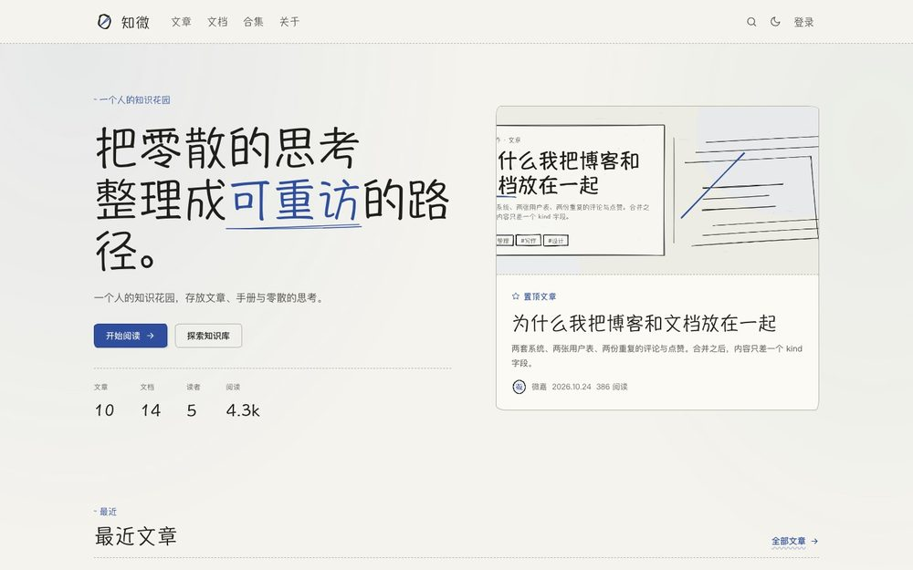
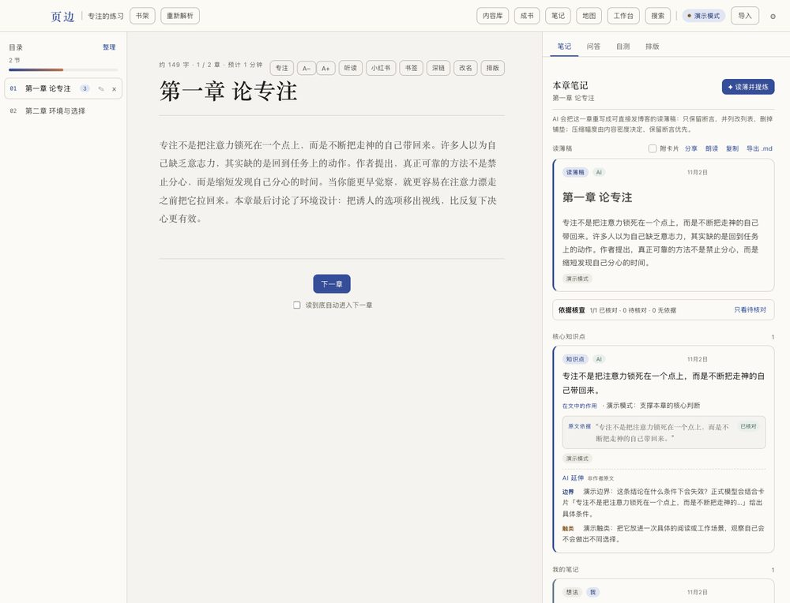
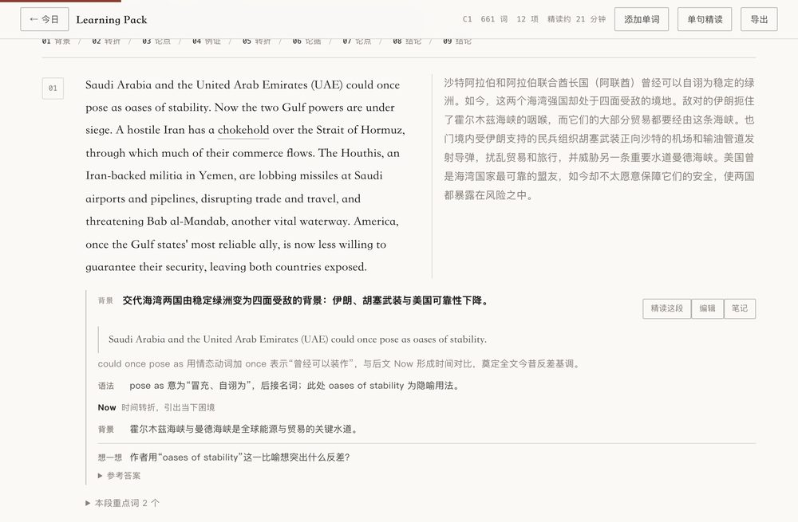
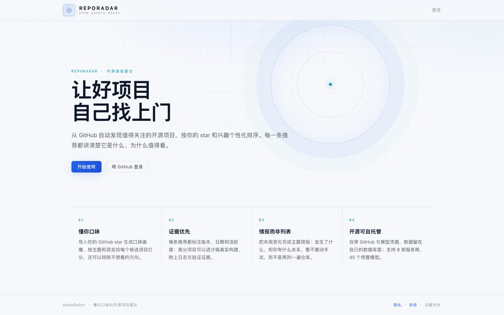
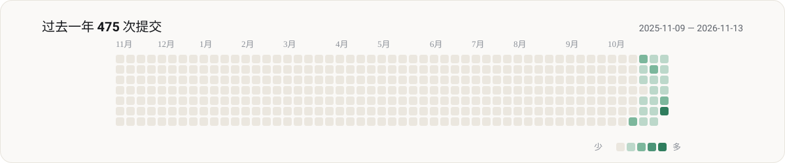

  

在上海做前端。业余写的项目大多围绕两句话：**数据留在本机**，**结论要能被验证**。
博客在 **[folio.weijia.asia](https://folio.weijia.asia)**，跑的是自己写的 [folio](https://github.com/qweijiaq/folio)。

只想看一个仓库的话，看 [anatomy](https://github.com/qweijiaq/anatomy)：644 个测试跑在 26 个文件里，两条不变量，还有一份自己承认候选召回率只有 60% 的评测记录。

## 现在在做

**[x-code](https://github.com/qweijiaq/x-code)** — 本地优先、模型无关的 AI 编程助手。桌面端与命令行共享同一份会话、记忆和技能，支持 Claude、GPT、Gemini、DeepSeek、Ollama 与任意 OpenAI 兼容模型，代码不出本机。

**[anatomy](https://github.com/qweijiaq/anatomy)** — 把一个仓库拆成带行号证据的设计笔记。模型写的每条主张先和磁盘上的字节比对，对不上的行号会被拒绝。

**[folio](https://github.com/qweijiaq/folio)** — Go + Vue 3 自托管个人知识站。博客、文档库、评论、RSS/SEO 与自带 Key 的 AI 问答是一个整体，`docker compose up` 就能跑。

## 截图

| [folio](https://folio.weijia.asia) | [ThinRead](https://github.com/qweijiaq/ThinRead) |
| --- | --- |
|  |  |
| **线上站点的首页**，Go 直接托管构建好的前端 | **阅读器**，章节读薄成草稿和核心卡片 |

| [CloseRead](https://github.com/qweijiaq/CloseRead) | [RepoRadar](https://github.com/qweijiaq/RepoRadar) |
| --- | --- |
|  |  |
| **精读界面**，逐段译文、笔记和折叠的词卡 | **首页**，从你正在维护的项目出发找下一块拼图 |

## 仓库

| 项目 | 一句话 | 栈 |
| --- | --- | --- |
| [x-code](https://github.com/qweijiaq/x-code) | 桌面端 + CLI 共享会话的 AI 编程助手 | TypeScript · Electron |
| [anatomy](https://github.com/qweijiaq/anatomy) | 仓库 → 带行号证据的设计笔记 | TypeScript · Electron |
| [folio](https://github.com/qweijiaq/folio) | 自托管知识站，线上实例就是这个博客 | Go · Vue 3 · SQLite |
| [ThinRead](https://github.com/qweijiaq/ThinRead) | 把一本书读薄成能发出去的稿子 | TypeScript · Electron |
| [CloseRead](https://github.com/qweijiaq/CloseRead) | 逐段精读、词卡、导出 Anki | TypeScript · CLI |
| [RepoRadar](https://github.com/qweijiaq/RepoRadar) | 用沙箱验证代替 star 榜的选库工具 | TypeScript · Next.js |

## 几个踩过的坑

写这些工具真正花时间的不是功能，是下边这种东西。

**1. 同一个调用重试 5 次就该中断。**
模型上一次工具调用失败了，下一轮最省事的做法是把同一行原样再发一次——Windows 上引号转义失败的 shell 命令最典型。`packages/core/src/agent/loop-guard.ts` 对 `{toolName, stableInputJson}` 做 SHA256 后回看最近 8 次调用：同一个哈希出现 3 次，注入一条合成的 tool-result 让它换思路；出现 5 次，直接中止本回合，不再往上下文里堆堆栈。

**2. 报告里的每句话都要能指到某一行。**
把模型引用的片段拿去和磁盘上的字节比对（`src/kernel/evidence.ts`），对不上就丢；judge 还会拒绝它引用一个从未展示给它的行号（`src/writing/judge.ts`）。两层都过才允许出现在页面上——这是 anatomy 唯一的产品主张，也是它最贵的地方。

**3. 分析别人的仓库时，一行代码都不能执行。**
不 clone、不装依赖、不跑脚本；Python 用 `ast` 解析，sidecar 以 `-I` 启动并清洗环境，否则仓库里放一个 `ast.py` 就能顶替标准库。

还有一条：Electron 在 agent shell 里会退化成纯 Node

环境里带 `ELECTRON_RUN_AS_NODE=1` 时，`require('electron')` 返回的是二进制路径字符串，`app` 是 `undefined`，窗口起不来。`run-electron.mjs` 在启动前把它删掉——这类只在特定 shell 里复现的问题，比功能难写多了。

## 最近写的

- [从一次问答到多轮工具调用：Agent 循环到底在循环什么](https://folio.weijia.asia/articles/12) — 2026-11-11
- [从零部署知微](https://folio.weijia.asia/articles/3) — 2026-11-09

更多在 [folio.weijia.asia](https://folio.weijia.asia)。

## 贡献

  

近 13 周的快照，不是实时数据：`python3 tools/contribution.py` 会去 GitHub 取真实数据重画一遍。
用自绘图而不是第三方统计卡，是因为那些公共实例会限流、会过期——之前主页上 69 张图里有 19 张是坏的。

## 关注

- **桌面端**：权限、签名、更新、窗口生命周期——只有真机上才会出现的那些。
- **本地优先**：默认不上传；需要联网的地方，应该说得清楚为什么需要。
- **可验证的 AI 输出**：让模型的主张落到行号、原文和比对结果上。

## 联系

[博客](https://folio.weijia.asia) · [CSDN](https://blog.csdn.net/weixin_44141520/) · [邮箱](mailto:2112025700@qq.com)

聊桌面端、本地优先工具，或者怎么证明模型没胡说，都欢迎开 issue。
